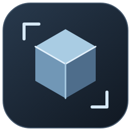
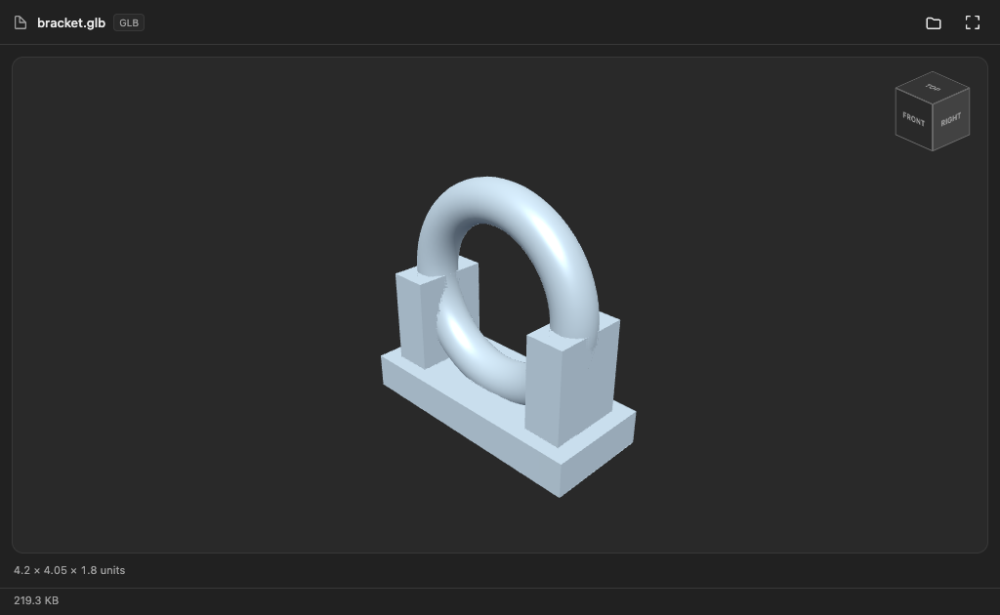

# Tesseract



Preview local 3D models, archives, media, and robotics recordings beside your Codex chat. Orbit a model, browse a ZIP, or flag a moment in an MCAP recording.



## Install in Codex Desktop

You’ll need [Codex Desktop](https://developers.openai.com/codex/app), the [Codex CLI](https://developers.openai.com/codex/cli), and [Node.js 22 or later](https://nodejs.org/).

1. Unzip the Tesseract release and open a terminal in the extracted `tesseract` folder.
2. Run both commands. The ZIP already contains the built app and its runtime dependencies.

   ```sh
   codex plugin marketplace add .
   codex plugin add tesseract@tesseract-local
   ```

3. Reopen Codex and start a local chat. Ask **“Open Tesseract so I can choose a file.”** Select **Open file** or drop a file onto the panel. Try the included `samples/bracket.glb` for a first preview.

You can also open a supported workspace file from Codex and select **Open with Tesseract** if prompted. Formats such as MP4, PNG, PDF, and source code can use Codex’s built-in viewers.

## What you can preview

| Files                                                                    | Preview                                                                         |
| ------------------------------------------------------------------------ | ------------------------------------------------------------------------------- |
| STL, GLB, glTF, OBJ, PLY, PCD                                            | Orbit, pan, zoom, view cube, part selection, and dimensions                     |
| STEP/STP, IGES/IGS, LAS/LAZ, VTK/VTU/VTP                                 | CAD geometry, point clouds, and supported scientific meshes                     |
| ZIP, TAR, GZ/GZIP/TGZ, NPZ, APK, CBZ, EAR, EPUB, IPA, JAR, KMZ, WAR, WHL | Browse entries and preview their contents                                       |
| MCAP, ROS1 BAG                                                           | Recording metadata, sampled messages, and supported MCAP camera playback        |
| NPY, H5/HDF5, NC/NetCDF, E57                                             | Array data, dataset metadata, and E57 scan headers                              |
| MOV/QT, M4V, MKV, 3GP/3G2, WEBA, MKA                                     | Video and audio playback when the host supports the codec                       |
| MP4, WebM, MP3, WAV, OGG, PNG, JPEG, WebP, GIF, SVG, AVIF                | Media previews are also available through Tesseract’s file picker               |
| Plain text and other files                                               | Text preview for readable UTF-8. Hexadecimal preview for unrecognized binaries. |

Most decoded previews cap input at 64 MiB. Archives also cap expanded data at 64 MiB and 2,000 entries. GLB and glTF must contain their own buffers and textures. RAR and 7z have hexadecimal previews. E57 shows metadata, and the VTK viewer supports legacy POLYDATA and a subset of ASCII XML meshes.

## Workspace access

Files picked or dropped into the panel are read by the viewer. For indexed inspection and agent-visible selections, explicitly grant the server a workspace folder. From the extracted package, run the commands below, then reopen Codex.

```sh
node scripts/configure-plugin.mjs "/path/to/project"
codex plugin add tesseract@tesseract-local
```

Repeat the path argument to add more roots. The bundled configuration grants server-side access to the included samples. Tesseract runs in the Codex side panel and communicates with its MCP server over standard input and output. Archive previews run in memory.

## Develop

See [CONTRIBUTING.md](CONTRIBUTING.md) for setup, tests, and how a file reaches its viewer. `npm run release` writes the install ZIP and SHA-256 checksum to `release/`.

Tesseract’s source is available under the [MIT license](LICENSE). Bundled dependencies retain the licenses listed in [third-party notices](THIRD_PARTY.md).
